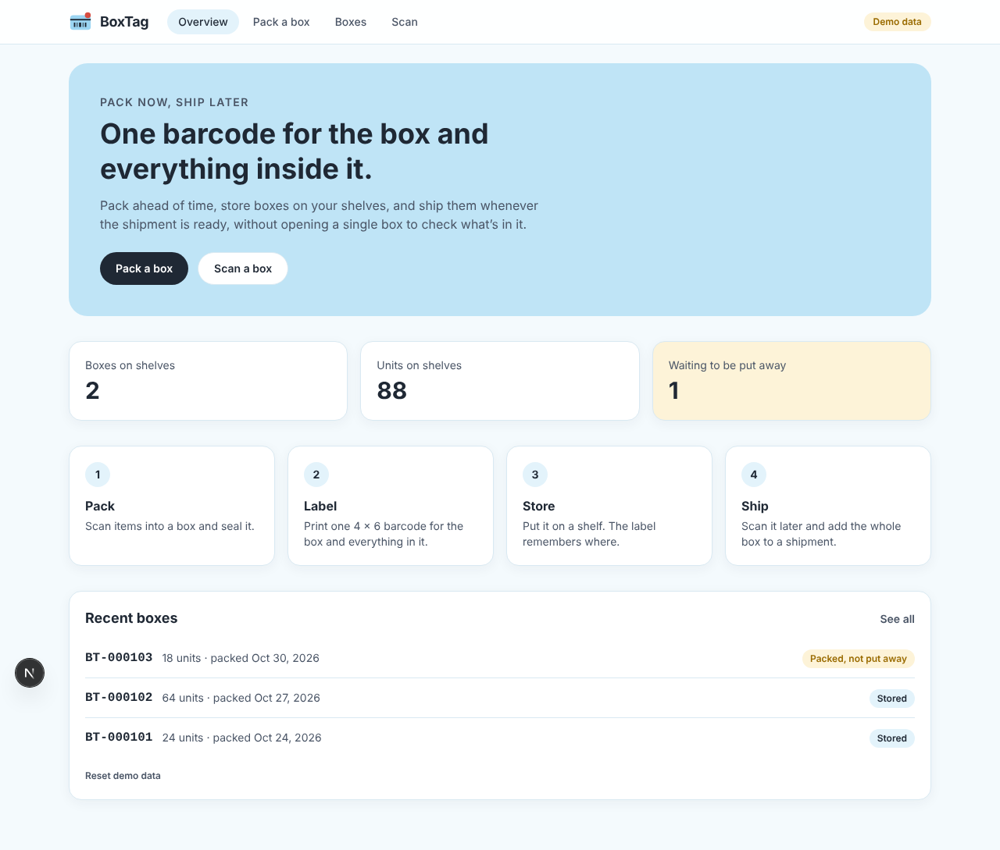
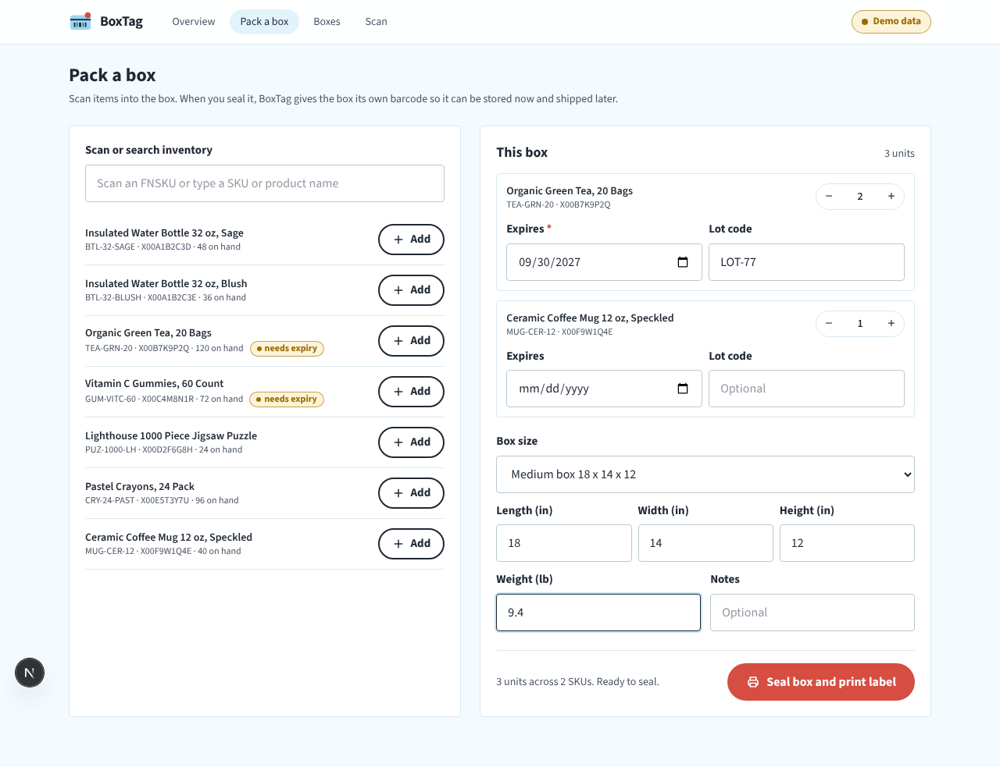
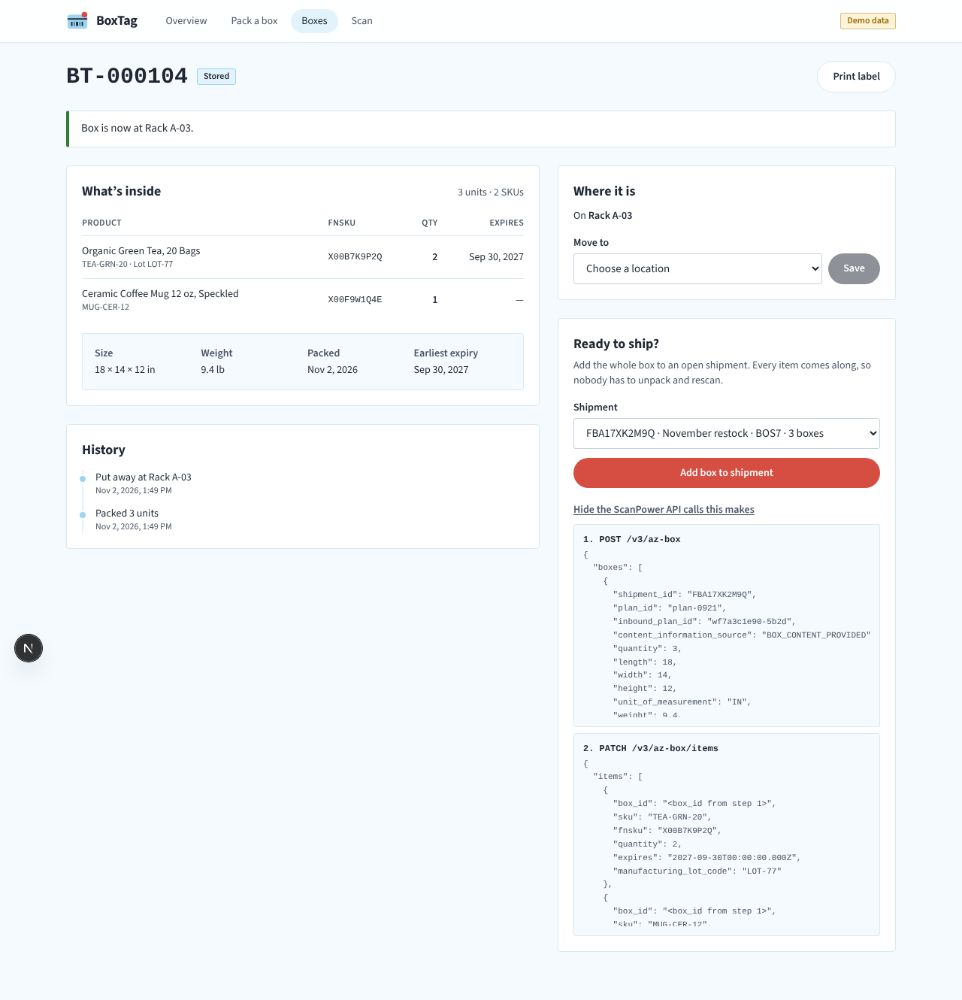
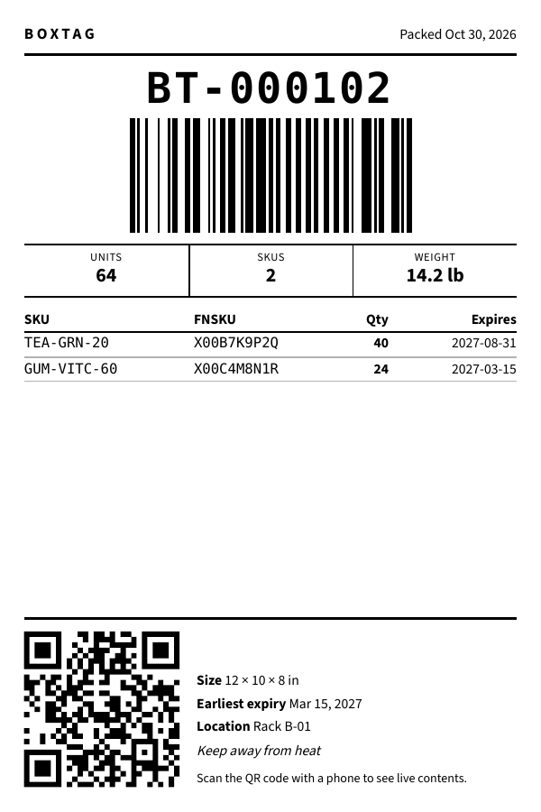

# BoxTag

BoxTag gives a packed box one barcode that stands for the box and everything inside it. A box can be packed today, stored on a shelf, and added to an Amazon shipment weeks later without anyone opening it to check what's inside. It's a proof of concept built against the ScanPower v3 API.



## The problem it solves

In ScanPower, a box (`/v3/az-box`) only exists as part of a shipment, and the box label endpoint (`/v3/label/box`) prints Amazon shipment labels. A box packed ahead of time has nowhere to live and nothing that records its contents. Warehouses usually handle this with a license plate number (LPN), a unique ID for a container and its contents. BoxTag adds that layer on top of what ScanPower already has.

## How a box moves through the app

```
pack ──> label ──> store ──> scan ──> ship
 │         │         │        │        └─ POST /v3/az-box, PATCH /v3/az-box/items
 │         │         │        └─ box ID or QR URL resolves to the box record
 │         │         └─ location from GET /v3/location, every move logged
 │         └─ Code 128 (box ID) + QR (box URL) on a 4 × 6 label
 └─ items from GET /v3/inventory, size from GET /v3/pack-template
```

Each box has a status of `packed`, `stored` or `shipped`, and a history of events (packed, label printed, stored, moved, shipped) with timestamps.

| Pack | Box page with API preview | Printed label |
|---|---|---|
|  |  |  |

## How the code is organized

```
src/
├── app/
│   ├── page.tsx                      Overview: boxes on shelves, recent boxes
│   ├── pack/page.tsx                 Scan or search items into a box and seal it
│   ├── boxes/page.tsx                All boxes, filtered by status or searched by SKU
│   ├── boxes/[id]/page.tsx           Contents, history, put away, add to shipment
│   ├── boxes/[id]/label/page.tsx     4 × 6 label preview and print
│   ├── scan/page.tsx                 Scanner, camera or typed ID lookup
│   └── api/scanpower/[...path]/      Server-side proxy to ScanPower (live mode)
├── components/
│   ├── BoxLabel.tsx                  The label layout, black on white for thermal printers
│   ├── Barcode.tsx                   Code 128 and QR codes as inline SVG
│   ├── AppHeader.tsx, StatusBadge.tsx
└── lib/
    ├── types.ts                      ScanPower types (field names from the OpenAPI doc) and BoxTag types
    ├── api/client.ts                 The one object every screen calls
    ├── api/mock.ts                   Sample-data source
    ├── api/live.ts                   Real ScanPower source
    ├── api/payloads.ts               Builds the az-box requests from a BoxTag
    ├── api/box-tag-store.ts          Box records, IDs and history
    ├── mock-data.ts                  Inventory, locations, pack templates, shipments, seed boxes
    ├── format.ts, useBoxTag.ts
```

## The data layer

Screens never fetch anything directly. They call `api` from `lib/api/client.ts`, which combines two pieces.

**A ScanPower source** for inventory, locations, pack templates, open shipments, and adding a box to a shipment. There are two implementations of the same `ScanPowerSource` interface, chosen by `NEXT_PUBLIC_BOXTAG_MODE`.

- `mock.ts` serves sample data shaped exactly like the v3 responses, with a short delay so loading states are real. Anything that exists only for the demo, like the three starter boxes, the "Demo data" tag and the demo box shortcuts on the scan screen, appears only in this mode, and each mode keeps its boxes in separate storage.
- `live.ts` calls `/api/scanpower/...`, a Next.js route that logs in with `GET /v3/auth` using Basic auth, caches the bearer token until just before it expires, and forwards requests. Only the five paths BoxTag needs are allowed through, and credentials stay on the server.

**The box store** (`box-tag-store.ts`) keeps BoxTag records, generates sequential IDs (`BT-000104`), and appends history events. ScanPower has no endpoint for a box that isn't in a shipment yet, so this demo keeps the records in the browser's local storage, with a fallback to memory if storage is unavailable.

Adding a box to a shipment is where the two meet. `payloads.ts` turns a BoxTag into the two requests ScanPower already accepts, first `POST /v3/az-box` with the dimensions, weight and unit count, then `PATCH /v3/az-box/items` with each SKU, FNSKU, quantity, expiration and lot code. The live source sends them. The box page shows the same payloads on screen, so what you see is exactly what would be sent.

| BoxTag action | ScanPower endpoint |
|---|---|
| Search inventory while packing | `GET /v3/inventory` |
| Choose a box size | `GET /v3/pack-template` |
| Put away or move a box | `GET /v3/location` |
| List open shipments | `GET /v3/az-shipment` |
| Add a box to a shipment | `POST /v3/az-box`, then `PATCH /v3/az-box/items` |

## Barcodes and the label

`Barcode.tsx` draws codes with bwip-js as inline SVG, so they stay sharp at any print resolution. The label carries two codes for two kinds of readers.

- **Code 128** holds only the box ID. Short and simple, so handheld warehouse scanners read it fast.
- **QR** holds the box's URL, so a phone camera opens the live record with current contents and location.

The label also prints the SKUs, FNSKUs, quantities, expiration dates, size, weight and location in plain text, so it's still useful with no device at all. Long boxes show the first seven SKUs and point to the QR code for the rest. Print CSS sets `@page` to 4 × 6 inches with no margins and hides everything except the label, so it comes out as a single page on Rollo and Zebra printers.

## Scanning

Most warehouse scanners act like a keyboard. They type the code and press Enter, so the pack and scan screens listen for Enter. On the pack screen, an exact SKU or FNSKU match adds one unit. On the scan screen, the input accepts a Code 128 box ID, a QR URL, or partial typing like `104`, and `normalizeBoxTagId` turns all of them into `BT-000104`. Where the browser supports the `BarcodeDetector` API (Chrome on Android and desktop), the scan screen can also use the camera.

## Rules the app enforces

- A box can't be sealed while any item that requires an expiration date is missing one.
- The earliest expiration in a box is shown on the label and the box list, so short-dated boxes ship first.
- A box that's already in a shipment can't be added to another one.
- Moving a stored box keeps its status and records the move. Shipping clears its shelf location.

## Status

Mock mode has been tested end to end in a browser, covering pack, label, put away, scan and ship, plus phone-sized screens and printing. Both barcodes on the printed label were verified with a decoder. Live mode is written from the v3 OpenAPI document and has not yet been run against a real ScanPower account.

A full version would move box records into ScanPower itself. One possible shape:

```
GET    /v3/box-tag?status=stored&location_id=...
POST   /v3/box-tag
PATCH  /v3/box-tag/{box_tag_id}
POST   /v3/box-tag/{box_tag_id}/ship
GET    /v3/label/box-tag?box_tag_ids=...
```

Since screens only talk to `api`, swapping the browser store for these endpoints wouldn't change any UI code.

## Built with

Next.js 15 (App Router), React 19, TypeScript, Tailwind CSS 4, and bwip-js for barcodes.

---

A proof of concept by Sarah Kayembe. Not an official ScanPower product. Product names and data in mock mode are made up.
